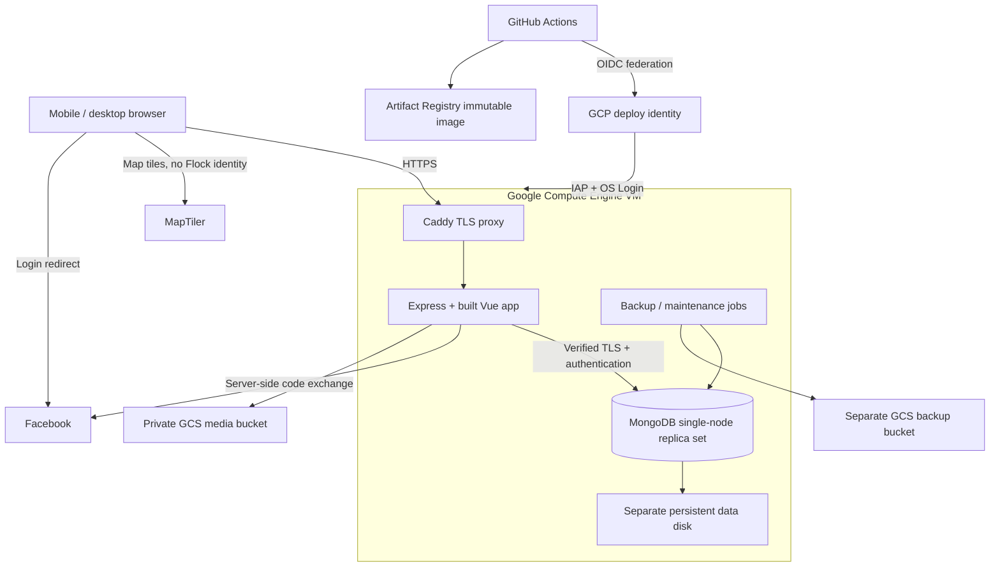

# Flock — application design

Status: integrated design draft, 30 October 2026. Design artifacts only: no application, GitHub repository, pipeline, DNS record or cloud resources have been created. The latest user instruction supersedes Atlas: **MongoDB runs on the same Google Cloud VM as the application.**

This document is the implementation authority. Specialist proposals are supporting analysis; where they differ, the decisions here take precedence. Provider capabilities and verification gaps are recorded in [provider evidence](provider-evidence.md). The supplied [mockup](../../Pigeon%20Tracker.html) is preserved unchanged.

## 1. Product and boundaries

Flock coordinates pigeon feeding and welfare observations at shared places. It does not track individual birds through GPS devices. Anyone can browse public places and anonymous activity. Facebook-authenticated members contribute; approved helpers and moderators can coordinate sensitive care cases through structured states. Public source code does not make the database, photos or secrets public.

| ID | Requirement and observable acceptance |
|---|---|
| R1 | Mobile-first, desktop usable: complete browse/login/add-place/feed/report flows at 360, 390, 768 and 1440 CSS pixels without horizontal page overflow or hidden primary actions. |
| R2 | Close to mockup: preserve map-first layout, purple controls, recency markers, magenta care badges, mobile bottom sheet and desktop details panel; compare screenshots at 390×844 and 1440×900. |
| R3 | Vue + Bootstrap frontend and Express backend: built Vue assets and versioned JSON API served under one HTTPS origin. |
| R4 | MongoDB on same GCE VM: no Atlas dependency; authenticated, TLS-protected, private replica set with durable storage and tested off-VM restore. |
| R5 | Facebook login: public browsing without login; verified server-side login grants a revocable session; cancellation never silently records an action. |
| R6 | Public sightings with privacy: public DTOs contain no user identifiers, Facebook profile data, private notes, exact care positions or care photos. |
| R7 | Public GitHub repo and real delivery: pushes to main, including merges, run required tests and deploy the tested image digest; failed tests prevent deployment and failed health checks restore the previous release. |
| R8 | `https://theflock.icet-lab.eu`: reserved VM address, DNS record and valid certificate; acceptance checks run against this exact origin. |
| R9 | Local testing: new checkout can run app, replica set, seeded data and local authentication without Facebook/GCP credentials. A separate mode tests genuine Facebook login. |
| R10 | No instant messaging: no inbox, conversation model, unread badge, message button, socket infrastructure or implied push alerts in v1. |
| R11 | Accessibility and language: keyboard/list alternative to map, labelled forms, adequate contrast/touch targets, English/Swedish UI, manual location fallback. |

### Included in v1

Public place map and list; place search; place detail; add place; feeding records with approximate flock size and editable observation time; care reports, one optional private photo, claim/release/resolve/reopen; emergency directory; Facebook onboarding; profile/privacy/export/deletion; basic moderation; English/Swedish; delivery, monitoring and backup procedures.

Not in v1: instant messaging, email/push notifications, live user tracking, automatic animal recognition, offline writes/background sync, social feeds, native apps, routing/geocoding service, arbitrary public profiles, or an availability guarantee. The app must not imply someone has been notified or dispatched.

Pilot: **Gothenburg, Sweden** (user confirmed). Configure Europe/Stockholm as directory/feeding-entry timezone; language follows saved preference, then supported browser language, then Swedish. Initial map centre `[11.9746, 57.7089]`, zoom12, is a proposed viewport anchor, not a jurisdiction boundary. Proposed supported pilot envelope is west11.4/south57.4/east12.6/north58.1; validate submitted places/care points against it and label it Gothenburg area. Operators can revise it through versioned configuration. Emergency directory scope is Gothenburg/Västra Götaland, with individually verified service coverage.

## 2. Visual and interaction specification

Source inspection and headless rendering confirmed the reference map layouts. The mockup contains 20 artboards; the [inventory](mockup-inventory.txt) maps them. Three messaging boards are excluded. The Facebook handoff is conceptual: Meta controls its own screen.

| Token | Initial value / use |
|---|---|
| Primary | `#4636A3`; hover `#2E2273` |
| Care | `#A3175F`, pale pink surface |
| Text / secondary | `#161B26` / `#586174` |
| Recency | green `#1E7F45`, amber `#F4C542` with dark text, red `#C83A2B`; neutral grey for unknown |
| Typography | Inter body; Space Grotesk headings; system fallbacks; self-host fonts with licences |
| Geometry | 22px mobile sheet top corners; 48px inputs; 52px primary actions; minimum 44×44px interactive target |
| Surfaces | White panels, muted grey map surroundings, fine borders, restrained shadows |

Define these as CSS custom properties and Bootstrap Sass overrides, not duplicated component literals. Domain status values map to tokens through one presentation module. Never encode status only by colour; include text, shape/icon and an accessible label.

**Mobile (<768px):** full-height map beneath search/language/login controls; horizontal status chips; locate and add buttons; a nonmodal place sheet with collapsed/half/full states. Provide labelled expand/close controls, not drag-only operation. Bottom navigation has Map, Emergency, Profile. Use `100dvh`, safe-area insets and keyboard-aware layout; scroll detail content independently. Forms open as dedicated routes/sheets with predictable Back behaviour and a visible save footer. Preserve a useful map area while a place is selected.

**Tablet (768–991px):** responsive split or overlay depending on available width, using the same components. **Desktop (≥992px):** header/search/navigation, map taking remaining width, approximately 360px detail panel. Keep primary actions visible and retain keyboard focus when selections change. Content forms have a readable max width rather than spanning the screen.

**Map/list parity:** accessible list toggle uses identical viewport/filter results. Search is for existing place names only in v1; do not label it “streets.” A manually selected pin is always possible. Browser geolocation is requested only after a user gesture, used while open, and never saved as a user's location. The user separately confirms any coordinate they submit as a place/care observation. Denial, inaccurate GPS, tile failure and unsupported WebGL retain list/manual entry.

**Feeding recency:** unknown without a valid log; recent for elapsed ≤48 hours; due for >48 and ≤96 hours; overdue for >96 hours. These are coordination heuristics, not proof that birds are hungry. Rename “Hungry” to “No recent feeding” / equivalent Swedish. The map and chips use mutually exclusive categories. Care is an independent overlay. Small = 1–14, medium = 15–50, large = >50; unknown is allowed. “No birds observed” is an explanatory no-action state, not a successful feeding: zero must not refresh feeding recency.

**Submission:** show field validation, pending state, success only after durable acknowledgement, recoverable server error and retry. Retain unsaved form data in memory during ordinary route navigation; never claim an offline save succeeded. Warn before discarding a dirty form. A login round trip may preserve a minimal draft in sessionStorage with a 30-minute TTL, excluding private notes, photo bytes and precise care text/coordinates; sensitive report creation asks for login first. Saved intent never triggers a mutation automatically after login.

**Care workflow:** “Report bird in need” describes an observation, not diagnosis. Replace “Send report · alert nearby feeders” with “Save report.” Public sees only a category/urgency/status at a shared place. Exact details and the optional image are private. “Offer help” for ordinary members explains that approved helpers can claim; approval is a moderator action, with no implied automated dispatch. Resolve/reopen and assigned-helper status replace messaging.

**Onboarding/privacy:** Facebook connects the identity; user chooses a private account display name and EN/SV. Public records say “Community member” without a stable alias/avatar or profile link. Profile has own contributions, language, logout, data export, delete account, and a clear explanation of public place pins and activity. Do not promise Facebook photos if they are not fetched; use local initials. Emergency and privacy pages remain usable while logged out.

**Emergency content:** region-specific records include organisation, phone, opening hours, verified source, verified date and review date. No prototype names/numbers/advice become production facts. Expired/unverified contacts are hidden or clearly unavailable; a wrong-number report enters moderation. Animal first-aid copy requires a verified authoritative source. Regional human-emergency numbers must be labelled for human emergencies, not bird rescue.

## 3. System architecture



Use a TypeScript monorepo: Vue 3 + Vite, Vue Router, Pinia for UI/session preferences, TanStack Vue Query for server data, Bootstrap 5 Sass and application-owned Vue components. Avoid Bootstrap JavaScript directly manipulating Vue-owned DOM. MapLibre GL JS behind `MapAdapter`; MapTiler-hosted light map style initially, with list fallback. Browser map key is public configuration, restricted by allowed origins and quota; no provider secret belongs in `VITE_*`. Tiles disclose IP/viewport to the provider and require attribution. Exact plan and terms are launch checks.

Express is a modular monolith: auth, users, places, feedings, care, media, emergency, moderation, health. Controllers validate inputs with shared schemas, services enforce policy/transactions, repositories use the official MongoDB driver. API/OpenAPI schemas drive frontend types. Error handling and response DTO projection are central. Repositories never return raw database documents to the browser.

One production image contains Express and the built frontend. Express serves immutable hashed assets; application HTML revalidates. `/api/*`, `/auth/*` and health routes are excluded from SPA history fallback. Local Vite proxies API/auth to Express for the same-origin browser experience. Node and dependencies are pinned to compatible supported releases and lockfile hashes during implementation; container/action references use immutable digests/commit SHAs.

Suggested new tree (none of this application code exists yet):

```text
apps/web/src/{routes,components,features,map,theme,locales}
apps/api/src/{auth,users,places,feedings,care,media,moderation,health}
packages/contracts/        # validation, DTOs, OpenAPI, shared enums
tests/{integration,e2e,security,fixtures}
ops/{compose,Caddyfile,mongo,deploy,backup,restore,bootstrap}
scripts/{dev,seed,migrate,smoke}
.github/workflows/{ci,release,maintenance}.yml
docs/{designs,runbooks}
```

## 4. Data contracts and consistency

All stored times are UTC instants; private instant display uses the viewer's locale/time zone. Public date-only values are already bucketed in Europe/Stockholm and labelled as Gothenburg dates; never reinterpret them as midnight UTC and shift them in the browser. GeoJSON points use `[longitude, latitude]`. Reject nonfinite/out-of-range coordinates, unknown fields, nested query operators and client-supplied roles/owner IDs. Public IDs are random UUIDv4 values with unique indexes; do not expose timestamp-bearing Mongo ObjectIds. Internal IDs are never authorization. DB validators and unique indexes back application validation.

| Collection | Key fields and indexes |
|---|---|
| users | internal ID, unique `facebookAppScopedId`, private displayName, locale, roles, account state, createdAt; no access tokens; unique provider identity index |
| places | name ≤100 chars, normalized search name, public point, creatorId private, moderation state, timestamps, revision; `2dsphere` point index, normalized-name index |
| feedings | placeId, authorId private, occurredAt, createdAt, flockBand/optional exactCount, foodTypes, private notes ≤1000 chars, visibility state; `{placeId, occurredAt:-1, _id:-1}` and author history indexes |
| careCases | placeId, public category/urgency/status, private point/description ≤2000 chars, reporterId, assignedHelperId, state version, timestamps, optional media reference; place/status/time and reporter/helper indexes |
| careEvents | caseId, actorId private, action enum, timestamp, private reason; index case/time; append-only state audit, no chat body |
| media | caseId, uploaderId, opaque object key/generation, state, normalized type/size/hash, expiresAt for abandoned uploads; unique one active attachment per case |
| emergencyContacts | region, organisation, phone, languages, hours, source URL, verifiedAt, reviewDueAt, published flag; region/published index |
| sessions / oauthAttempts | opaque session identifier, minimal user reference, expiry/absolute expiry and CSRF state; one-use OAuth state; TTL plus explicit expiry checks |
| idempotency | actor+method+route+key unique, canonical payload hash, result reference/status, expiry; TTL 24 hours |
| moderation / audit | target ID, reason enum/private explanation, actor, action, time; limited retention, no OAuth credentials |
| migrations / deletionJobs | applied migration IDs/checksums; resumable deletion task and progress; unique IDs |

Do not add denormalized place recency in v1: derive latest visible feeding by `occurredAt,_id` using indexed per-place lookups after bounding the place query. This avoids stale recency after backdating, moderation and deletion. Aggregate only anonymous band/count summaries and currently active care counts. Benchmark realistic datasets before changing to caches; a future materialized cache must update transactionally and be reconstructible.

**Feeding time:** `occurredAt` defaults to server now, allowed back seven days; reject >5 minutes into future and clamp accepted small clock skew to server now. `createdAt` is always server-generated. Timestamp changes are explicit edits with an audit record. Public history exposes only Europe/Stockholm calendar date and server-derived recency category/day label; exact occurredAt/createdAt, hidden sort values and actor identifiers stay private, including in cursors and IDs. Own history can show precise time. Public status changes can still reveal that activity happened recently; coarsening is not anonymity proof. Invalid “future feeding” must not keep a place green indefinitely.

**Add place + initial feeding:** checkbox defaults off everywhere. When selected, show the same flock/time fields; submit once in a transaction. Either both records exist or neither. Show possible nearby duplicates within 30m; user can select an existing place or explicitly confirm a distinct place. Concurrent duplicates are moderated rather than claiming a geospatial uniqueness guarantee.

**Idempotency:** every creation and state-transition request has a client-generated key. Store key/hash/result within the same Mongo transaction as the domain change. Same actor/key/payload returns the committed result; different payload returns 409. A uniqueness race retries the lookup; an unknown commit outcome retries commit/read, not a fresh creation. Creation records additionally retain unique `(actorId, clientRequestId)` for their lifetime; retain a seven-day retry tombstone after removal and return410 rather than resurrecting a deleted record. Reauthorize every replay and regenerate the allowed DTO instead of returning an old private response. Duplicate-submit protection is not merely a disabled button. Nontransactional image work follows the separate media protocol below.

**Care states:** `open → claimed → resolved`; `claimed → open` on release; `resolved → open` on reopen. Moderator may hide/unhide any record without erasing audit. Reporter/moderator may resolve; current approved assigned helper may resolve; only reporter/moderator may reopen. Only a moderator-approved helper may claim an open case. Claim eligibility and mutation share a user authorization-fence write with concurrent role/account revocation, inside the same transaction. Claims compare state/version in an atomic conditional update; losers receive 409 and refresh. Role revocation immediately removes private access and releases an assignment through a transaction. Use a two-hour claim lease renewable by an explicit structured observation; expiry returns the case to open and immediately removes helper access even before worker cleanup. Label an observation unconfirmed after24h, without implying resolution. A staying-with-bird flag, if supplied, is private and expires after30min. Structured observation codes are seen_present/no_longer_seen/needs_attention; resolution codes are rescued/recovered/no_longer_seen/duplicate/other. Resolution text must distinguish observation from confirmed rescue. Withdrawal sets a separate withdrawn visibility flag, blocks public/helper reads and follows terminal-data retention. No timeout silently asserts a bird has been rescued.

**Permission boundary:** public care DTO includes shared place point and generic category, urgency, public status, coarse dates. No free text, people, photo or precise observation coordinate. Private case endpoint requires reporter, moderator, or current assigned approved helper, checked on every request including media. User signup alone grants none of those additional permissions. Reporters can use the nearest shared public place but exact bird position is separate. A person must confirm a place is appropriate to publish; private residences/sensitive nesting locations should not be submitted as exact public places.

### API surface

All API paths below start `/api/v1`. Responses include stable error codes and request IDs, without stack traces. Writes require session + CSRF and authorization unless explicitly a provider-signed callback.

| Method/path | Contract |
|---|---|
| GET `/places?bbox=&zoom=&status=&cursor=&limit=` | Public, bounded viewport; maximum 200 places per page, stable cursor, `hasMore`; at broad zoom return coarse clusters, never silently truncate as complete. |
| GET `/places/search?q=&cursor=` | Public normalized prefix search, 2–100 chars, limit 20; no user-supplied regex. |
| GET `/places/:id` | Public place, recency/flock summary and care summary; unpublished place returns404. |
| POST `/places` | Member, public point confirmation, optional initial feeding; transaction and idempotency. |
| PATCH `/places/:id` | Creator/moderator, revision check; moving a place with history requires moderator review. |
| GET `/places/:id/feedings` | Anonymous history with Europe/Stockholm calendar date, flock and food type; cursor, max50; no author identifiers/notes. |
| POST `/places/:id/feedings` | Member, validated observation, idempotency. |
| PATCH/DELETE `/feedings/:id` | Author/moderator, revision check; delete hides immediately, recency recalculates. |
| POST `/care-cases` | Member, public/private field separation, creates case before optional photo upload. |
| GET `/care-cases/:id` | Public safe summary; does not conditionally mix in private fields. |
| GET `/care-cases/:id/private` | Authorized participants only; `Cache-Control: no-store`. |
| POST `/care-cases/:id/{claim,release,observe,resolve,reopen,withdraw}` | Role/state/version check and idempotency; append event atomically. Observe renews a valid helper lease; withdraw hides the case and revokes helper access. |
| POST/DELETE `/care-cases/:id/photo` | Reporter/moderator; bounded upload or removal; private media lifecycle. |
| GET `/care-cases/:id/photo` | Authorized participants, streaming normalized image only, no-store. |
| GET `/emergency-contacts?region=&locale=` | Public verified directory and verification dates. |
| POST `/content-reports` | Member flags place/feeding/case/contact; rate-limited moderation queue. |
| GET/PATCH `/me`; GET `/me/contributions` | Private account/preferences and own records/notes. |
| POST `/me/export`; DELETE `/me` | Fresh identity confirmation; bounded asynchronous export / deletion job; clear status and retention notice. |
| GET `/me/jobs/:id` | Owner-only export/deletion status while identity remains active; separate opaque deletion receipt after erasure. |
| GET `/moderation/reports`; POST `/moderation/reports/:id/action` | Moderator queue and allowlisted hide/unhide/dismiss actions with target kind, expected version and reason; audited. |
| POST `/moderation/users/:id/helper-approval` | Moderator, grant/revoke approved-helper capability and reason; fresh identity confirmation and audit. No moderator-grant API. |

Also provide `GET /session` for current session/CSRF bootstrap, `GET /places/:id/care-cases` for public paginated case summaries, and `GET /me/exports/:id/download` for authorized export streaming. `/auth/facebook`, `/auth/facebook/callback`, `POST /auth/logout`, `POST /auth/facebook/deauthorization`, `POST /auth/facebook/data-deletion` and `/data-deletion/status/:receipt` sit outside the API prefix. Public web routes include `/map`, `/places/:id`, `/places/new`, `/places/:id/feedings/new`, `/care-cases/new`, `/care-cases/:id`, `/emergency`, `/login`, `/welcome`, `/profile`, `/moderation`, `/privacy`, `/terms` and `/data-deletion`. Role guards on pages are convenience; API checks remain authoritative.

Mutations on existing resources require `If-Match` version (428 missing, 412 stale); state/occupied-claim or idempotency-payload conflict is409. Use400 malformed,401 missing session,403 known forbidden capability,404 unreadable object,413 body too large,415 unsupported media,422 field validation,429 quota with Retry-After,503 retryable dependency failure. Error body is `{error:{code,message,requestId,fields?}}`; private data never enters errors. Successful writes return committed ID/version and serverTime; deletes return204 or202 plus deletion receipt for asynchronous erasure.

Fixed food codes are `grain_mix | seeds | dried_peas | other` (optional, no preselection); Swedish translations must match the same meaning, not silently change seeds to sunflower seeds. Care issues are `wing_injury | limping | entangled | sick | unable_to_fly | young_alone | other`, multiple selections allowed; urgency `now | today` requires a choice, birdCount integer1–1000. Flock exactCount, when supplied, is integer1–10000 and must match the chosen band. Place notes from the mockup are private creator/moderator notes≤500 characters, not an accidentally public description. No free-text public care summary in v1.

The first moderator is granted by an audited operator-only command after the person has completed genuine Facebook login; look up their internal account ID, never infer authority from display name/email. Moderators can grant helper eligibility but cannot grant moderator privileges through the web app. Suspension/deletion fails all private reads and writes; hidden/withdrawn cases restrict access to reporter/moderator, and deletion blocks everyone except the erasure job. Case exact position must lie within1km of the selected public place; the UI prompts for a more suitable place otherwise.

Map maximum span is 1° in either axis for point results. Wider views return server-side grid clusters of public places with no private fields; cap 200 cells, increase cell size if necessary. Bound candidate scans to5,000 visible places, bbox area to2,500km² and database runtime to250ms; above a bound return a clear ZOOM_IN_REQUIRED response rather than unbounded aggregation or misleading partial totals. Validate bbox ordering; reject antimeridian-crossing requests with an explicit unsupported-range response; the regional UI normalizes its view accordingly. All counts are for the current query extent/filter, not an unexplained global total. Debounce pan/search, abort superseded fetches, set query timeouts and cap public query rates. For point paging use stable `(createdAt,_id)` order; feeding paging uses `(occurredAt,_id)`. Cursor is authenticated-encrypted with a 15-minute lifetime and bound to query filters/scope so private exact sort times are not exposed by base64 decoding. Reject tampering/expired cursors and let the client restart paging.

## 5. Authentication, security and privacy

**Facebook flow:** `/auth/facebook` creates a cryptographically random, one-use state bound to a short-lived browser pre-session and an allowlisted relative return route. Redirect to Meta; callback validates state/expiry and exchanges code server-side using a fixed configured redirect URI. Check provider app/user identity and token validity, then regenerate the session ID and redirect to a clean URL. Request only necessary public profile identity, not email/friends/publishing. Do not persist provider access tokens or expose them to JavaScript. No SDK is necessary in the page. Meta app mode, allowed callbacks, Graph version and applicable review requirements are launch dependencies, not completed work.

Use `express-session` with Mongo storage, not in-memory production sessions or localStorage JWTs. Production cookie: `__Host-flock.sid`, Secure, HttpOnly, SameSite=Lax, Path=/, no Domain. Proposed session limits: 24-hour idle and seven-day absolute expiry; sensitive export/deletion needs a newly validated Facebook identity confirmation within 15 minutes, bound to the existing account. This is a fresh OAuth identity check, not a claim that Facebook forced password/MFA reentry; a redirect by itself is insufficient. The OAuth attempt stores expectedUserId and purpose before redirect; a mismatched returned identity aborts the sensitive flow before modifying its session or records. Enforce expiry/disabled roles on reads even before TTL cleanup. Logout is POST with CSRF and server invalidation. OAuth denial leaves the original action uncommitted and offers a retry.

Synchronizer CSRF token on all browser mutations, strict configured Origin/Fetch-Metadata checks, JSON content types where appropriate, multipart CSRF before upload work, exact-origin CORS or none. OAuth GET callback is state-protected. Meta deauthorization/data-deletion callbacks are explicit CSRF exceptions authenticated by verified provider signature, strict algorithm, payload shape, size and replay-safe idempotency; return an opaque confirmation receipt. Exact Meta callback requirements must be verified before shipping.

Trust only the known Caddy proxy hop; the app has no public port and Caddy overwrites forwarding headers. Permit only the configured host. Helmet/CSP, HSTS after HTTPS validation, `frame-ancestors 'none'`, restrictive Permissions-Policy, no raw HTML user content, safe URL schemes, no credentials/query strings in access logs. Test CSP with MapLibre workers and tile/font endpoints: a map-specific `worker-src` exception is preferable to `unsafe-eval`. Self-host code/fonts; Vue renders strings as text. Rate limits cover login, writes, map queries, exports and images, with per-user and IP controls and limits shared across release slots.

**Threats and controls:** forged identity → server OAuth/state/session rotation; CSRF → token and origin validation; IDOR → object-scoped checks and explicit DTOs; scraping → anonymous minimized public data and bounded endpoints; malicious upload → bounded reencoding worker; NoSQL injection → typed input/allowlisted queries; leaked public repo → secret scanning/no secrets in builds; compromised app → nonroot container, narrow data/IAM roles, no Docker socket; compromised VM → off-VM protected backups, revoked credentials and rebuild procedure. Encryption at rest does not protect data from a compromised running VM.

**Private photo protocol:** create the report first; photo failure must not lose it. Accept one JPEG/PNG/WebP input, ≤10MB compressed and ≤20MP decoded; reject SVG/GIF/archives/remote URLs and unsupported HEIC with clear guidance. Check signatures, stream limits, timeout and decode resource limits; normalize to max1600px, remove all metadata, reencode. Original bytes only in bounded temporary storage, never public or retained. Run decoder with concurrency1, memory/CPU limit and no network/cloud credentials. Parent API uploads only normalized bytes to private GCS using an opaque generated key and immutable generation. DB media row moves `pending → ready` only after object success; unique active-photo constraint prevents duplicates. Reads serve only ready rows authorized through the parent case. Pending rows/orphans cleaned after24h; deletions are retryable jobs. GCS Public Access Prevention and uniform bucket access; no public signed URLs, no CDN caching. Do not revoke access only in the UI.

**Secrets and Mongo:** Google Secret Manager stores Facebook secret, session-signing key ring, runtime DB credentials and private CA material with narrow access; app receives only its own read-only-mounted runtime files. Mongo admin/migration/backup credentials are separate. Production `requireTLS` with verified hostname/CA, X.509 replica membership and separate SCRAM-SHA-256 application users limited to the application/session data. Explicit net.tls.allowConnectionsWithoutCertificates=true permits these SCRAM clients to connect without a client certificate while still requiring TLS and user authentication; never permit invalid server certificates. This chooses simpler client credential rotation over client certificate auth; X.509 clients remain an upgrade option. Local development uses its own generated CA/keyfile/credentials. Mongo has no published production port. Keep CA private signing key off the runtime VM; provision leaf certs and rotate before expiry. Alert at30/14/7 days and exercise rotation; never disable verification to fix expiry.

**Retention and deletion defaults:** application security/audit logs90d with personal fields scrubbed on erasure, request logs30d and raw IPs≤7d, sessions per expiry, abandoned uploads24h, resolved-care private detail/media30d then remove, anonymous feedings365d. Open cases unobserved for90d become hidden pending moderator review and private-data purge within30d unless explicitly reconfirmed. Target active-system account erasure within24h; alert/escalate failed deletion jobs, never silently claim completion. Immediately hide removed content and revoke sessions/access. User deletion removes Facebook identity, own notes, private reports/photos and personal audit fields; public shared place records may remain without attribution; authored feeding rows are removed and summaries recompute. State this policy before contribution. A durable deletion ledger outside normal DB backups records internal object/user IDs for90d so restores reapply erasures before exposure. Deletion first marks the account deleting and revokes sessions; it must durably append the off-VM ledger entry before purging source records or reporting completion. A retryable outbox bridges Mongo/GCS failure; unavailable ledger writes leave the job pending and alert the operator. Provider callbacks retain a protected payload digest/opaque receipt to make retries harmless even after account recreation; verify current provider timing/replay semantics before shipping. DB recovery copies have35d retention with a37d verified-purge target; private media retirement plus recovery retention has a target of up to41d after an account deletion request. Disclose active removal separately from inaccessible recovery copies, monitor overdue purges, and do not claim immediate erasure of every backup copy. Exports exclude other users' private data and expire after1h. These are proposed product policies; privacy/legal notices and operator contact must reflect actual operation rather than claim automatic legal compliance.

Clear private query caches, drafts, local object URLs and in-memory participant views on logout, expiry or lost authorization. No service worker or private offline cache in v1. Private routes/media/auth are `no-store`. Public API initially uses no-store too, keeping moderation/deletion immediate and avoiding cache identity mistakes; hashed frontend assets alone are long-lived cached. Static emergency content can render an error/fallback but must not falsely present stale contacts as current.

## 6. VM, deployment and operations

One GCE Linux VM in an EU region, provisioned reproducibly. Initial sizing proposal: 2 vCPU/8GiB RAM and a separate ≥50GB balanced persistent data disk; confirm cost and capacity against expected use. This is an estimate, not a benchmark. Pin OS/container versions. Initial hard limits: Mongo3GiB with WiredTiger cache1.25GiB, each app768MiB with Node heap384MiB, decoder256MiB/concurrency1, Caddy128MiB, minter96MiB; reserve ≥1.5GiB for host/kernel/cache. Backup verification uses a ≤1.25GiB temporary Mongo with smaller cache; a shared maintenance lock prevents its overlap with blue/green release. Bound scratch space and refuse jobs lacking headroom. These limits must pass the concurrent load/backup experiment. Mongo cache and app/media-worker limits leave memory for OS and temporary deployment overlap; alert on pressure. Data disk is retained on instance deletion and mounted by UUID with startup refusing to run Mongo on an absent/empty mount. Separate boot and data lifecycle; Mongo never writes its data into an ephemeral container layer.

Reserve a regional static external IPv4; DNS `A theflock.icet-lab.eu → reserved IP`. Do not publish AAAA unless IPv6 is configured and tested. Public firewall allows80/443; SSH22 only via IAP, with OS Login. Remove permissive default rules. Only Caddy is externally published; Mongo and application networks are private. Caddy persists certificate state and renews automatically. GCP disks/storage encrypt at rest; verified HTTPS/TLS protect network paths. Admin access uses MFA and restricted IAM, never shared root passwords.

Application app/service containers are nonroot, read-only where possible, capability-dropped with resource limits and writable tmpfs only where required. Mongo has a deliberate persistent volume and no public port. VM metadata access is blocked from general application containers; app cloud access uses short-lived file-fed storage tokens, not an unrestricted metadata token shared with image processing. Document that shell access and VM root can ultimately access the VM's attached identity; do not portray container IAM isolation as protection from root.

**Concrete storage identity:** attach a dedicated vm-host service account. A root-owned systemd minter alone can reach metadata; give it iam.serviceAccounts.getAccessToken only on named storage/job accounts. Every5min it calls IAM Credentials generateAccessToken for a600s app-storage token and atomically renames token.json inside a root-owned /run/flock/app-storage tmpfs directory, mode0440/app-only group. Read-only mount the DIRECTORY, not the file, into app slots so atomic replacements are visible. App-storage can get/create media objects and create deletion-ledger entries, not list/delete objects, access secrets or administer buckets. Host retirement and backup jobs use separate identities/directories. The app adapter rereads token/expiry before GCS JSON API operations, uses OAuth2Client.setCredentials and request headers with a60s refresh threshold, and never uses ADC/metadata/refresh-token fallback. A token with <60s validity waits for a fresh file or fails retryably; a401 reloads once and retries only a generation-preconditioned operation. Decoder has no token/network. Test denial from containers and nonprivileged host users, including deploy shell; vm-host/root remains a powerful trusted boundary. Root bootstrap independently fetches only named Secret Manager versions into per-service secret directories; private CA signing key is excluded.

### CI/CD release contract

Workflow files are implementation deliverables, not claimed operational here. Use GitHub-hosted ephemeral runners, not the production VM as a runner. The pipeline must perform the following actual stages; no placeholder `echo deploy`, silent missing-secret skip, or unconditional success:

1. `pull_request`: read-only repository permissions, no production/OIDC secrets. `npm ci`; lint; TypeScript; unit and component tests; real replica-set integration tests; browser E2E against production build; accessibility; secret/dependency/container checks. No cloud access needed. Do not use privileged `pull_request_target` to execute contributor code.
2. `push` to `main` (merges and direct pushes): run those gates again for the exact SHA. Build image once, test that exact production image in isolated CI Compose with real Mongo and external OAuth/GCS protocol doubles (production clients unchanged, no test adapter inside the image); record commit and test evidence. Fail if required secrets/configuration are absent later in deployment, not in credential-free PR tests.
3. Save/load and publish the successfully tested image to GCP Artifact Registry without rebuilding. Record the saved artifact checksum and local config digest separately from the registry manifest digest: they are not equal identifiers. A fresh verifier then pulls the registry digest and reruns release-image acceptance; only this verified registry digest is eligible to deploy. Build/publish privilege exists only in this trusted main job. Generate SBOM/provenance and a signed deployment-eligibility attestation binding registry digest, commit, workflow run and passed required gates; scan runtime image; immutable dependency/action pins and CODEOWNERS for workflows/ops reduce supply-chain risk.
4. GCP authentication through GitHub OIDC Workload Identity Federation, restricted to immutable repository/owner IDs, `refs/heads/main`, push event and the designated workflow/environment. The caller invokes a reviewed reusable release workflow by full commit SHA; require exact job_workflow_ref/job_workflow_sha in federation trust, not merely a mutable filename. Publication, final-digest verification and deployment use separate scoped identities/environments. Trust-pin updates are reviewed infrastructure changes. No service-account JSON key in GitHub. GitHub environment permits main without a mandatory reviewer so successful main pushes deploy automatically as requested.
5. Deploy job depends on every gate and publish; serialize production releases with `cancel-in-progress: false`. GitHub may replace pending runs even with cancellation disabled: each main push triggers tests, but a superseded intermediate release need not be deployed; record supersession, never report it as deployed. Recheck current main SHA and refuse an obsolete candidate; repeat under VM deploy lock. Explicit manual rollback may target a previously verified digest. Retain deployment record with SHA/digest/start/end/result.
6. Through IAP + OS Login invoke a root-owned deploy helper with validated digest/SHA arguments. It can pull only the fixed registry repository and modify app release slots; it cannot run arbitrary scripts supplied from the PR/release or recreate Mongo volumes. Helper verifies the eligibility attestation, fixed registry, candidate SHA/digest/run and trusted signer before running it. It uses root-owned templates, never Compose/mount/env overrides from the image or checkout. CI account gets narrowly scoped OS Login/IAP and actAs on the VM service account as required, no Owner/Editor. Docker group membership is root-equivalent and is not granted casually.
7. Helper checks storage/backup freshness, free memory, schema compatibility and exclusive lock; starts candidate beside active app on a private slot. Executes backward-compatible versioned migrations with a separately created per-release Mongo migration user mounted only into the migration job. A host watchdog removes that user/tmpfs secret on completion/failure/reboot (Mongo users have no automatic TTL), then probes readiness. Never run `compose down -v`; app releases do not restart/upgrade Mongo or Caddy.
8. Candidate readiness verifies DB authentication, replica primary, required schema/index version and app build identity. Run the rollout as a named host systemd operation with a durable state journal, independent of SSH connection lifetime; reconcile incomplete operations after reboot. After success and one last main-SHA check atomically update/reload Caddy upstream; smoke-test the public HTTPS origin, static asset, map API and returned commit. Drain old requests, retain previous image/config/compatible secret versions for rollback and immutable frontend asset files for seven days so old tabs do not lose lazy-loaded chunks. Caddy serves a root-managed hashed-asset store populated only from the verified image via validated safe paths; retain active/previous assets longer if needed. Existing frontend clients receive a reload-required response for incompatible API versions rather than silent bad writes. Recheck health over a bounded observation window, proposed60s.
9. Failed candidate or post-switch smoke restores the previous upstream/image and verifies it. The Action still fails and reports rollback outcome. Failed rollback raises an operator alert and displays a maintenance page rather than a false successful deployment. No migration auto-downgrade: releases require N/N−1 schema compatibility; destructive changes wait for a separately planned maintenance release.

Runtime API `/health/live` confirms process survival; `/health/ready` tests required DB/schema dependencies with a timeout; public `/api/v1/version` reports only commit/release ID, not configuration. Health does not depend on live Facebook/tile availability. Temporary dependency failures yield bounded503 errors; sessions and logged-out browsing never fall back to a fake user.

**IAM/secrets inventory:** GitHub has nonsecret project/zone/instance/registry/WIF identifiers; GCP holds deploy/publish identities and runtime secret versions. Artifact writer is repository-scoped; VM identity reads only that repository, needed secrets and the media bucket, and appends backups. Backup deletion/restore permissions belong to separate operator identities. IAM and bucket permissions must be tested with explicit deny cases. No exact project/repo IDs are invented in the design.

### Backup, restore and failure handling

Single-node replication enables transactions/oplog; it provides no redundancy or automatic failover. VM/zone failure means downtime. Provisional recovery targets: RPO6h, RTO4h, to validate in a timed drill. Full authenticated TLS `mongodump --oplog --archive --gzip` every4h with a≤1h verified completion budget, without database filtering incompatible with full oplog capture; ensure oplog retention exceeds worst dump duration, detect failures, checksum/upload to a private retention-protected GCS backup bucket. Before marking a backup complete, restore the archive with mongorestore --oplogReplay in a constrained isolated verifier under the maintenance lock; derive media generation/hash references from that restored snapshot, not an inconsistent live query. Verify every referenced generation exists. Upload archive, checksum, manifest and completion marker under unique names; partial uploads are not recoverable completed backups. Manifests include server/tool version, migration version, capture interval and exact media object references/generations. Never treat an uncoordinated live file copy as the authoritative backup.

Media keys are immutable and never reused; put uses ifGenerationMatch=0. Enable GCS Object Versioning. On deletion, a separate host retirement identity deletes the live object name with the expected-generation precondition but WITHOUT selecting a generation, moving it to noncurrent state. Active DB references are hidden/removed immediately. Keep noncurrent generations38 days after retirement, target verified purge by40d; do not use creation age to delete old-but-recently-referenced images. Set extra soft-delete retention explicitly to zero rather than inherit an additional window. Restore reads exact generations after ledger reconciliation. This preserves media for every still-recoverable DB backup. Backup writer cannot delete existing backup objects. Backup objects become eligible for lifecycle deletion at35d; target verified purge by37d and alert overdue cleanup. Monitor recoverable snapshot CAPTURE age, not upload modification time: warn above5h and treat6h as a breached RPO. Lifecycle is asynchronous; these are operational targets, not assertions of exact physical deletion at midnight. Protect secret recovery and CA signing material separately; a backup without credentials/certificates and restore instructions is insufficient. Boot/data snapshots are supplementary recovery aids.

Monthly restore drill into an isolated disposable environment: restore compatible Mongo + oplog, recreate/verify identities/indexes and selected media, apply deletion ledger, expire every restored session/OAuth attempt/export token, reset restored helper/moderator privileges to member and clear all helper assignments (regrant through the operator after identity verification, avoiding resurrection of revoked roles), rotate runtime secrets as appropriate, run consistency/privacy checks, measure recovery, destroy drill data securely. Disaster recovery rebuilds VM and mounts recovered disk/data before opening public traffic. Release rollback is not database restore; never overwrite current data merely to undo a UI release.

Monitor uptime/TLS, request latency/error rates, Mongo replica/disk state, CPU/RAM, disk thresholds (warn70%, critical85%), backup age, certificate expiry, failed login spikes and deployment results. Logs omit names, precise positions, private notes, images, session/OAuth secrets and query strings. Send operational alerts to an operator-selected channel during provisioning; no operational alert integration has been configured in this design task. Set budget alerts for VM/disk/storage/network/maps; exact monthly cost requires region/traffic/plan choices.

## 7. Local development and meaningful tests

Define these commands during implementation (they do not exist yet):

```sh
npm ci
cp .env.example .env.local
npm run dev:setup       # generate local-only keys, start/init authenticated rs0, apply indexes
npm run dev:seed        # fictional users/places and every recency/care state
npm run dev            # Vite + Express, localhost proxy, local fake OAuth provider
npm run test:unit
npm run test:integration
npm run test:e2e
npm run test:release    # built container, TLS proxy, real Mongo, browser checks
```

Default development browser origin is https://localhost:8443 through a local TLS proxy; generate a local CA and document explicit user trust/removal rather than silently changing OS trust. Certificate SANs cover localhost/127.0.0.1/mongo; container clients use mongo:27017 and host clients localhost:27017 with dev-only directConnection=true. Local rs0 bootstrap uses the empty-database localhost exception inside Mongo's network namespace to initiate rs0 and create the first administrator, then authenticated least-privilege users/indexes. Repeated setup authenticates existing volumes and refuses credential mismatch; never starts a public unauthenticated listener. Stage keyfile permissions in a Docker volume with the correct Mongo UID for macOS. CI additionally tests production X.509 membership configuration. Document Docker/Compose + pinned Node prerequisites, Intel/Apple Silicon compatibility and a container-only alternative. Host development replica-set discovery must use a documented reachable hostname/port (or development-only `directConnection=true`), not an unreachable `mongo` container hostname. Bind developer DB ports only to127.0.0.1. Never connect a dev command to production credentials; seed/reset commands reject nonlocal host/database names and require an explicit disposable DB identifier.

Local fake Facebook provider emulates state/code exchange, denial, invalid/replayed state and logout; selected fixture users have server-assigned roles. Fake auth/media/tiles are opt-in source-development/test dependencies, excluded from production runtime layers; production startup also rejects fake-adapter flags. For exact-release-image E2E, an isolated test network resolves the real provider hostnames to external TLS protocol doubles, using ephemeral synthetic credentials and a test-only CA trust mount; production OAuth/GCS clients and allowlists are unchanged. The external harness supplies and rotates the synthetic storage access-token file. Test code/fixture routes never enter the image. The root-owned production deploy helper forbids CI DNS/hosts overrides, test trust roots, fake credentials and test mount paths. Doubles cover only the documented protocol; real-provider checks remain separate. CI E2E sets roles only through isolated fixture setup, never a public `/test/login` endpoint. Use a separate Meta development app and registered HTTPS development callback/tunnel for genuine login testing; a local fake login is not evidence that Meta works. Never share production Facebook credentials locally.

| Layer | Required behaviour tested |
|---|---|
| Unit/contract | 48/96h boundaries, unknown vs zero, >50 band, UTC/DST formatting, schemas, coordinate order, redaction, state transitions, locale parity |
| Real DB integration | TLS/auth denial, replica transactions, rollback on partial create, duplicate/retry idempotency, concurrent claim and role revocation, backdated latest record, deletion recompute, expired-session denial before TTL cleanup, bounded geospatial queries |
| Security | State replay/open redirect/session fixation; CSRF; all role/object combinations; identity/location/photo DTO leakage; hidden records not in map/search/counts; upload bombs/malformed types; fake-provider production rejection |
| Browser | Logged-out browse, login return/cancel, GPS denial/manual pin, new place+feeding, stale-version conflict, report/photo failure/retry, claim/resolution, EN/SV, deletion/export; mobile keyboard, keyboard/list flow, screen-reader labels |
| Delivery | Gate failure blocks publish/deploy; tested image digest matches release; main push deploys; fork PR cannot obtain GCP credentials; stale release cannot overwrite newer; failed readiness/smoke rolls back without touching DB |
| Recovery | Empty/missing disk refuses Mongo startup; backup upload failure alerts; isolated full restore plus deletion-ledger replay; restored sessions invalid; permissions revoke media access immediately |

Stub third-party map/Facebook calls in deterministic CI and label them. Before launch, separately verify real Facebook login, real GCS media authorization, tile credentials/quota, DNS/HTTPS, full deployment and restore. Synthetic CI tests and a green build alone are not that evidence. Use meaningful fixtures around boundary/privacy/race conditions rather than tests that mirror source code.

Proposed performance targets: public API p95<500ms at20 requests/s with10k places/100k feedings on target VM, and mobile LCP≤2.5s under a documented throttled profile. These are acceptance experiments to run, not present results or promised SLAs. Poll care/feeding data at most every60s while visible and refetch after mutations; no background polling when hidden. Paginate and cluster rather than fetching the whole dataset.

## 8. Delivery sequence and launch gates

1. Scaffold monorepo/contracts, styles/routes, local replica set/fake provider, lint/tests/credential-free PR CI. Checkpoint: local setup from a clean checkout and screenshot comparison.
2. Build Facebook adapter/session/security plus places/feedings/public projections and real DB tests. Checkpoint: anonymous browsing and authenticated write, duplicate-submit and privacy tests.
3. Build care states/helper approval/private media, emergency content, moderation and account lifecycle. Checkpoint: participant authorization/race tests, image failure recovery, export/deletion.
4. Add reproducible VM bootstrap, DNS/TLS, persistent disk/certificates/IAM, registry/WIF, actual main release workflow and rollback. Checkpoint: a real main commit changes the public release SHA; intentionally failing candidate preserves previous release/data.
5. Prove backup restore, real Meta flow, production privacy headers, mobile/accessibility/performance and operator handover. Checkpoint: launch evidence recorded, not merely a checklist ticked in this design.

Provisioning inputs still needed: GitHub owner/repo and licence choice; GCP project/billing/region/VM access and operator identity; DNS zone control; Meta app/secret/verified settings; map-provider account; approved Gothenburg pilot map bounds; verified local rescue directory; privacy/terms/operator contact. These are configuration/content tasks, not reasons to block writing the design. No credentials should be pasted into design docs or committed to the public repo.

## 9. Decisions, alternatives and limits

| Decision | Alternatives and reasoning |
|---|---|
| One VM + self-hosted Mongo | User choice supersedes Atlas. Managed DB or multi-node service improves operational isolation but is outside current scope; document shared failure domain instead of promising HA. |
| Same-origin modular monolith | GitHub Pages + separate API adds cookie/CORS/deploy coordination; microservices add operations without a v1 need. GitHub hosts source and CI/CD, GCE hosts runtime. |
| Single-node replica set | Standalone Mongo simplifies startup but lacks multi-document transaction semantics used here. More nodes on the same VM would not provide useful failure independence. |
| Server session, Facebook only | Browser JWT/localStorage increases token exposure/revocation complexity; extra password auth contradicts scope and adds support/security work. Facebook outage blocks new logins but public browsing can continue. |
| Private GCS photos | Mongo binary blobs/local-only media complicate VM backup/storage pressure. Object storage keeps photo data private and recoverable; provider IAM is still a required dependency. |
| MapLibre + hosted map tiles | Raw public OSM tile service is best-effort and policy-limited; self-hosting tiles on this VM adds disproportionate storage/operations. Keep renderer/provider swappable. |
| No direct messaging/notifications | Explicit v1 exclusion; structured case actions do not imply someone was alerted. |
| No offline writes/service worker | Avoid duplicate reports, stale permissions and private persistent caches initially. Offline UI is honest; later queue/PWA needs its own conflict/privacy design. |
| Blue/green app slots | Brief stop/start simpler, but candidate health/rollback is safer for automatic deploy. Both slots share one DB and schema compatibility, not high availability. |

The residual risks are explicit: one VM is a shared failure point; public place pins can be copied; approved helpers are trusted with care details; cloud/Meta/map approvals and quotas are not yet verified; image moderation and privacy notices require an operator; disk encryption cannot defend against runtime compromise; backups retain deleted data for a bounded interval before expiry. These are design limits, not claims that the user has accepted every operational risk.
